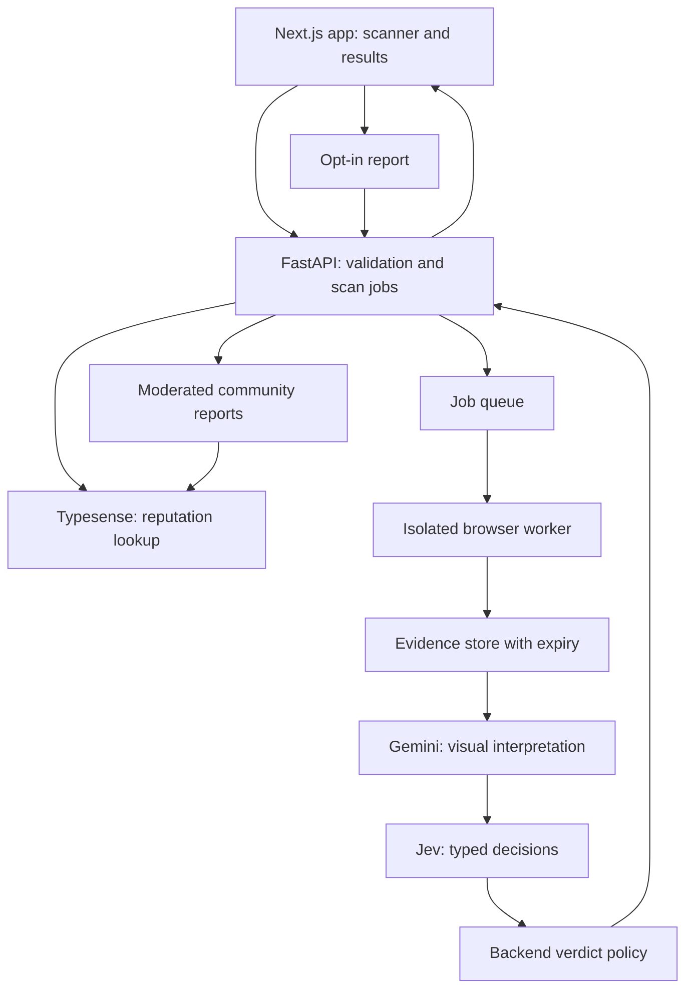

# QR Scam Checker

**Check a QR link before you open it.**

QR Scam Checker is a proposed hackathon app that investigates QR destinations in a remote browser, explains suspicious behavior, and lets users warn others through an opt-in community map.

> Scan a QR code before you trust it. Our AI checks the destination remotely, explains suspicious behavior, and helps warn your neighborhood.

## Project status

This README describes the planned v1 architecture and demo. The scanner, backend, sandbox, AI integrations, and map are not implemented yet. API contracts and directory names below are proposals.

## The problem

QR codes on parking meters, restaurant tables, flyers, and delivery notices can lead to impersonation pages, credential theft, or unwanted downloads. A person scanning a code often has little context about its destination.

The app decodes the QR without navigating to its URL, then checks the destination remotely before presenting a result.

## The v1 experience

**Scan → check in the background → review the evidence → choose what to do.**

1. **Scan or paste a URL.** Decode the QR inside the app. Do not automatically open the destination. Request camera access only when scanning.
2. **Check existing reports.** Look up the URL and domain globally. Nearby reports provide additional local context; a missing report does not establish safety.
3. **Start a background scan.** The backend returns a scan ID immediately. The app displays progress while an isolated worker investigates the destination.
4. **Collect evidence.** Record the redirect chain, final destination, screenshot, visible text, password and payment forms, popup attempts, and download attempts.
5. **Analyze the findings.** Gemini interprets visual and textual evidence; Jev returns typed decisions from structured observations and model findings. Backend policy determines the displayed verdict.
6. **Show the result.** Present the verdict, specific reasons, final hostname, screenshot, and scan time.
7. **Let the user act.** View details, explicitly open an eligible destination, or opt in to publish an approximate location report.

The result appears inside the app. FaceTime, live narration, and text messaging are outside v1.

### Result language

| Result | Meaning | Default action |
| --- | --- | --- |
| **High risk** | Strong suspicious evidence or a sufficiently reliable existing finding | Block the normal open action and explain why |
| **Uncertain** | Conflicting or insufficient evidence | Keep a warning visible; offer details and retry |
| **No threats detected** | The completed scan found no supported threat indicators | Offer an explicit open-link action with the destination visible |
| **Could not complete check** | Timeout, worker error, blocked access, or unavailable analysis | Offer retry; never convert failure into a favorable verdict |

“No threats detected” is not a guarantee. Sites can change, hide behavior from automated browsers, or behave differently for another visitor.

## Architecture



The app polls scan status for v1. The API remains responsive while the worker runs. Raw browser observations remain available separately from AI interpretations so the result can be traced to evidence.

### Stack

| Component | Responsibility |
| --- | --- |
| **React / Next.js** | QR scanner, pasted URL input, progress, results, and map |
| **FastAPI / Python** | Input validation, scan lifecycle, AI orchestration, verdict policy, and reports |
| **Vultr** | Host the API and a separately isolated scanning worker |
| **Docker + Playwright** | Disposable browser execution, navigation evidence, and screenshots |
| **Gemini** | Interpret screenshots and explain supported findings in plain English |
| **Jev** | Typed classifications and scores from text and structured evidence |
| **Typesense** | Searchable reputation records and geographic report lookup |
| **Leaflet + OpenStreetMap** | Community map with clustered approximate-location pins |
| **Job queue + expiring evidence storage** | Background execution, status tracking, and bounded artifact retention; implementation to be selected |

## Evidence and verdict policy

The browser collects observations; models interpret those observations; application code controls actions.

Useful evidence includes:

- Submitted and final hostnames, redirect hops, and navigation failures.
- Visible brand claims compared with the destination domain.
- Password, payment, or recovery-phrase requests and form destinations.
- Download and popup attempts.
- Screenshot and text excerpts supporting each reason.
- Scan timestamps, completion status, and reputation provenance.

A login form alone does not make a site malicious. Classification should consider several signals and preserve uncertainty.

Jev receives text or structured data, including Gemini's screenshot findings. Do not send screenshots directly to Jev. Keep model confidence separate from the application's risk score.

An initial experimental policy may use:

| Risk score | Proposed route |
| --- | --- |
| At least 0.8 | High risk |
| At least 0.5 and below 0.8 | Uncertain; request additional analysis if available |
| Below 0.5 | Eligible for “No threats detected” only when the scan is complete and evidence is sufficient |

These thresholds require validation. A model score of 0.94 must not be advertised as proven “94% scam” accuracy. Missing evidence, model failure, or incomplete execution overrides a favorable score.

Page text and screenshots are untrusted input. Model instructions must treat them as evidence, never as authority to change the task. Models receive no credentials, payment tools, or permission to execute page instructions.

## Browser isolation requirements

Deleting a container after a scan is only one layer of isolation. Before enabling arbitrary public URL scanning:

- Keep scanning workers separate from the API, database, and application secrets.
- Run the browser as a non-root user with the Chromium sandbox enabled and an appropriate seccomp policy.
- Do not mount the Docker socket, host directories, credentials, or user sessions into the worker.
- Restrict outbound traffic through an enforcing network boundary. Block loopback, private, link-local, metadata, and other non-public destinations for IPv4 and IPv6.
- Apply destination checks to redirects and every browser request, including subresources and popups; account for DNS changes between validation and connection.
- Accept only HTTP(S) URLs. Reject unsupported QR payloads and embedded URL credentials.
- Bound execution time, redirects, CPU, memory, response sizes, and concurrent scans.
- Observe and cancel download attempts; never execute downloaded content or submit credentials and payments.
- Destroy the browser environment after each job, including on failure.
- Rate-limit submissions to prevent the service becoming an unrestricted browsing proxy.

Use controlled benign and simulated malicious pages for the initial demo. Public scanning requires isolation verification first.

## Reputation, map, and privacy

Reputation lookup and map search serve different purposes:

- **Global lookup:** has this exact URL or domain already been reported or analyzed?
- **Nearby search:** where have people reported suspicious physical QR codes?

Use exact normalized identifiers for reputation matching. Typo-tolerant search supports discovery, not automatic blocking. A domain-level report is context, not proof that every URL on that domain is malicious. Recheck stale findings.

Location is optional. Ask permission only when a user chooses to report, round the position to an approximately 100 m area before upload, and explain that the pin is public. Do not publish exact coordinates or user identity.

Community reports must be labeled separately from verified findings. Add deduplication, abuse controls, expiry or revalidation, and a correction/removal path before a public rollout. Scan findings alone do not automatically publish a pin.

URLs can contain access tokens or personal information. Redact sensitive query values from logs and public reports, restrict access to scan artifacts, and expire screenshots and extracted content. Send AI providers only the evidence needed for analysis. The design does not promise complete anonymity or zero retention.

## Proposed API

| Method and route | Purpose |
| --- | --- |
| `POST /api/scans` | Accept a URL and return a scan ID with HTTP 202 |
| `GET /api/scans/{scan_id}` | Return progress, completion status, or failure details |
| `GET /api/scans/{scan_id}/result` | Return verdict, reasons, final destination, and evidence references |
| `POST /api/reports` | Publish an explicitly approved report with approximate location |
| `GET /api/reports/nearby` | Return reports within a bounded radius |

Proposed job states: `queued`, `running`, `analyzing`, `completed`, and `failed`. A failed job includes a reason such as timeout. Keep job status separate from verdict.

Result artifacts must have access controls; a scan ID alone should not grant access to another user's screenshots or private URL.

## Suggested repository layout

```text
apps/web/             Next.js scanner, results, and map
services/api/         FastAPI routes, jobs, and verdict policy
services/worker/      Playwright collection and worker lifecycle
packages/contracts/   Shared request, evidence, and result schemas
fixtures/             Controlled QR destinations and sample codes
infra/                Container and deployment configuration
tests/                Integration, isolation, and evaluation checks
```

These directories are planned. Setup commands will be added with the implementation.

## Hackathon build order

1. Define shared evidence and result schemas; create controlled demo pages and QR codes.
2. Build QR decoding, pasted URL input, and a results screen with fixture data.
3. Implement background jobs and Playwright evidence collection.
4. Connect Gemini and Jev; apply explicit backend verdict rules.
5. Add Typesense reputation lookup and opt-in map reports.
6. Verify failure handling, worker cleanup, and isolation; rehearse the demo.

### Demo

1. Scan a QR pointing to a controlled fake parking-payment page.
2. Show background progress while the remote worker collects evidence.
3. Display “High risk” with the screenshot and specific impersonation indicators.
4. Explicitly opt in to publish an approximate Atlanta map pin.
5. Scan a legitimate test destination and show “No threats detected.”
6. Demonstrate a timeout returning “Could not complete check.”

### Validation

Measure results on a labeled set of controlled legitimate and simulated malicious pages:

- False positives and missed threats, reported separately.
- Uncertain and failed scans, without counting them as correct classifications.
- Median and p95 completion time, plus cache-hit response time.
- Evidence quality: each explanation should be supported by collected observations.
- Resistance to page-based prompt injection.
- Network blocking across redirects, subresources, and IPv4/IPv6 destinations.
- Worker cleanup after completion, timeout, and crash.
- Consent and coordinate rounding before any public map report.

Report dataset size and limitations alongside metrics. Do not claim production phishing-detection accuracy from a small demo set.

## Deferred features

- FaceTime, live browser streaming, narrated calls, and SMS.
- Real parking purchases, food orders, and autonomous checkout.
- Solana payments; an explicitly approved devnet or mock checkout may be a later demonstration.
- Accounts, long-running monitoring, and advanced reputation feeds.

Any future payment flow needs its own trusted execution path, a visible merchant and amount, and explicit user approval. Payment credentials and wallet keys must never enter the scanning worker.

